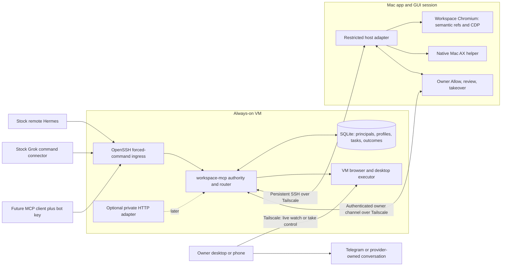

# Target architecture: one VM authority, private MCP, local execution

**Status: proposed for implementation. Decision date: 2026-10-27.** This ADR chooses the architecture for production Hermes and Grok Bot, with future agents admitted through the same contract. It changes documentation only. Desired behavior, protocols and numerical budgets below are decisions, **not claims that they already ship**; production compliance is **UNVERIFIED** until the acceptance gates pass.

Use **one `workspace-mcp` service on the always-on VM**, reached primarily through **restricted OpenSSH stdio over Tailscale**. It owns authenticated bot profiles, approvals, routing, action outcomes and cross-host write authority. The Mac app owns its visible browser, native GUI executor and human permission surface; the VM browser host executes continued browser work. Keep existing drivers, tool names, provider-owned conversations and the live VM window. Do not build an agent runtime, transcript database or second scheduler.

Preserve the seven [core commitments][R236]: simple workspace, fast remote Mac/browser control, lid-close continuation, live VM desktop, same provider threads across devices, stock agents and proactivity. A Grok activity/link pane does not fulfill actual left-side chat; supported embedding remains **UNVERIFIED**.

## Evidence and present topology

Code baselines: `alans-way@7e05d521c2a2f9add46423e39a4b27d6e67049e3` and `alans-way-agents@4da7c64bcf11fec0c10c1cddc569ec125a93a032`. `agents:` means the second repository; relative links mean the first. Six research drafts are pinned below. Sources were read with `git show`, without inspecting another worktree or installed private state.

**New operational fact supplied by Alex:** on Oct 26–27, Grok Bot's computer reached the VM over Tailscale SSH and discovered **14 tools**. Accept that as connection evidence; the older “Grok outbound SSH is blocked, therefore public HTTP is necessary” conclusion in [remote-agents.md](../../desktop/docs/remote-agents.md) and [R232][R232] is superseded. Exact daemon, forced-command enforcement, image consumption, account-wide versus per-bot credential isolation, persistence after computer recreation and end-to-end action latency are **UNVERIFIED** here. This week's reported flaky Tailscale on Grok's box is a design input; its root cause and incident rate are **UNVERIFIED**.

The “three servers” to consolidate are three MCP-facing implementations, not evidence of three production daemons running simultaneously:

| Current component | Actual responsibility | Target disposition |
| --- | --- | --- |
| [`agents:alans-way/scripts/workspace-router.cjs`][router] | VM stdio MCP proxy; host discovery, failover, commit elicitation and tab mapping; normally starts an SSH connector to Mac or a VM connector. | Becomes the routing/session module of `workspace-mcp`; retain its recovery behavior. |
| [`desktop/scripts/browser-mcp.cjs`](../../desktop/scripts/browser-mcp.cjs) | Stdio server named `hermes-cua-alans-way`; 8 `cua_alans_way_*` and 6 `workspace_computer_*` tools; translates calls to host APIs. | Its schemas/results remain the public contract; translation becomes internal host adapters, with a compatibility launcher. |
| [`agents:alans-way/scripts/remote-agent-bridge.cjs`][bridge] | Optional `/mcp` HTTP front; one router child per session, fixed bot flags/token per listener; currently strips elicitation. | Keep disabled by default; later transport adapter to the same authority, without its own policy/router state. |

Keep [desktop loopback HTTP](../../desktop/src/main.cjs) and [VM browser/CDP execution](../../desktop/scripts/vps-browser-host.cjs) as internal host services, not MCP authorities. The optional [Python read-only file MCP](../../src/hermes_companion/mac_server.py) stays compatible. The [Hermes computer provider][provider] starts another router child today; consolidate its state while retaining observation adaptations.



All machine-to-machine tool, mirror and viewer legs use Tailscale; local IPC stays local. Telegram/model/provider traffic retains provider networking. No desktop API, CDP, VNC or public Funnel exposure is introduced.

## 1. Transport — SSH stdio over the tailnet

**Choose restricted OpenSSH stdio as the primary transport for Hermes, Grok and new command-capable MCP clients.** Reuse persistent connections/multiplexing, UTF-8 framing, strict pinned host keys and stderr-only diagnostics. Agent computers connect directly to the VM, so laptop sleep removes no ingress dependency. A VM-local Hermes uses its own bot key through the same SSH ingress over loopback; only trusted frontends may access the internal service socket.

Distinguish **SSH carried by Tailscale** from the **Tailscale SSH daemon**: the latter intercepts tailnet port 22 and authenticates node identity instead of OpenSSH bot keys. Choose a tailnet-only OpenSSH VM tool listener on **2222** with per-key `restrict,command=...`; keep administrative Tailscale SSH on 22 separate. Alex's success proves reachability, not this final restriction. Qualify that listener and verify the Mac runtime endpoint also reaches OpenSSH before changing client configuration. [Tailscale SSH documentation](https://tailscale.com/docs/features/tailscale-ssh), [OpenSSH authorized-key restrictions](https://man.openbsd.org/sshd.8#AUTHORIZED_KEYS_FILE_FORMAT).

**Streamable HTTP is a later private compatibility adapter**, enabled only for a demonstrated HTTP-only client. It must bind credential to principal, validate Origin/protocol/session handling, support the needed request/approval flow and share the same ledger. The existing JSON-only bridge cannot relay browser elicitation; it must continue refusing unsupported commits. HTTP supports JSON or SSE responses; a reconnect/session ID is not an exactly-once action guarantee. [MCP transport specification](https://modelcontextprotocol.io/specification/2025-06-18/basic/transports), [current bridge][bridge].

Rejected alternatives:

- **HTTP as the default:** adds an ingress/auth/session implementation without improving the newly demonstrated Grok command route or fixing tailnet failures.
- **Tailscale node identity alone:** identifies a computer/user, not two bots sharing that computer.
- **Public Funnel or public SSH fallback:** changes the exposure model and cannot be an automatic network-repair mechanism.

## 2. Topology — one authority on the VM, executors on both hosts

**Choose one supervised `workspace-mcp` service on the VM.** SSH sessions are lightweight frontends. SQLite holds principals, approved profile revisions, logical task/tab mappings, leases and action outcomes; the broker retains bounded private checkpoints. Store no transcripts or page secrets in the ledger. Initially reuse repository boundaries and plugin entry points; avoid a simultaneous package move.

Mac execution stays inside the app GUI session for TCC/native access; see [computer.cjs](../../desktop/src/computer.cjs). Reuse persistent host channels/helpers. Both service policy and host validation must pass. Authority failure pauses new agent writes while human browsing remains usable; restart the service without electing the Mac.

Rejected alternatives:

- **Mac-only server:** loses policy, approvals and routing precisely when the lid closes.
- **Independent Mac and VM MCP authorities:** creates conflicting grants, profiles and task owners during partitions.
- **Active-active VM cluster:** adds consensus and recovery complexity before a single-node supervised service has failed its availability target.

## 3. Identity and authorization — one bot key, one principal, revocable grants

**Choose an operator registry mapping each bot-key fingerprint to one immutable principal/profile.** Model arguments, display names and headers cannot select authority. Operator-installed forced commands ignore requested shell commands/environment overrides and admit only their fixed principal; clients receive neither shell nor app token. Tailscale grants restrict device reachability; the bot key identifies the application caller.

Run the service/registry under a dedicated OS identity; Hermes and other agent shells cannot read/write its private state, signing key, broker app token or runtime Mac key. The service signs host dispatch grants over principal, profile digest, host boot identity, resource, action digest, generation and expiry; the app verifies the pinned service key. The app retains its local token internally. Same-user full-shell access to the Mac still defeats application-level controls: do not claim hostile-agent isolation until those credentials are separated. Existing [connect-mac.sh](../../scripts/connect-mac.sh) installs a broader shell path; introduce a **new restricted runtime key**, keep admin/file-tool credentials separate and never reuse that broad key in remote connectors.

**Desktop Allow binds to `(principal, credential generation, Mac device, desktop-input scope)`**, never just a friendly bot ID. Preserve today's 40-second prompt, 30-minute idle Allow and 60-second denial cooldown from [desktop-approval.cjs](../../desktop/src/desktop-approval.cjs). “Always allow” is an owner-approved profile revision for desktop access only. Replacing a key starts a new credential generation; permanent grants require an explicit owner rebind. Consequential transactions retain separate approval.

Revocation atomically disables the principal/key generation, closes all sessions, rejects queued work and pending approvals, withdraws host grants and stops lease renewal. Removing `authorized_keys` alone does not terminate existing sessions. A reachable host refuses immediately; an isolated host stops new dispatch within the five-second grant bound in decision 4. Already accepted third-party effects cannot be undone. Offer revocation in the existing access settings; do not require quit/edit/restart.

Rejected alternatives:

- **Shared app token plus self-declared bot header:** lets a credential holder select a more trusted identity.
- **One credential for every Grok Bot on an account:** cannot prove the acting bot; bind one disclosed account principal unless distinct credentials are demonstrably isolated.
- **Copying current trusted-bot lists without review:** preserves implicit privileges without establishing their authenticated owner.

## 4. Lease and handoff — one writable task host, preserve uncertain outcomes

**Choose VM-owned logical browser tasks with expiring host grants; retain host-local epochs.** A logical task/tab maps to exactly one writable physical host/tab and a monotonically increasing handoff generation. Serialize Alan-controlled input per logical tab; native input also takes the existing 20-second-idle desktop lease, extended to the VM executor. Reads do not acquire input ownership. Human takeover cancels queued input and bumps the local epoch immediately; returning control requires fresh state. Wire VM viewer Take control to a host-local human hold that pauses VM agent input until Stop control; today [remote.js](../../desktop/src/remote.js) does not provide that lease coordination, so this is required MVP work. The guarantee covers Alan's input, not autonomous website JavaScript or arbitrary human actions.

A host requests a **five-second** dispatch grant and renews every **two seconds**. Its expiry is anchored to the host's sleep-aware monotonic time **when it sent the request**, not when the reply arrived; the VM expires the grant five seconds after receipt, so the host stops no later than the VM's reassignment bound without synchronized clocks. Reject late replies, bind grants to host boot nonce/task/generation and check validity immediately before **each** input dispatch. Suspend clears grants; wake/reboot must reconcile with the VM before input. A timer alone is insufficient when an event loop stalls. Long batches renew between bounded steps; never let expiry release a still-running uncertain effect.

Handoff transaction:

1. While local work runs, acknowledge sequenced checkpoints on the VM; prioritize the active task and target p95 age ≤2 seconds, marking readiness degraded above 5 seconds. Suspend-time push is best effort, never the only copy.
2. On explicit move or lost host health, freeze new input; finish/cancel and classify each in-flight action. Require source revocation acknowledgement **or grant expiry** before another host receives write authority.
3. An already-sent action with no definitive outcome becomes `unknown`; expiry permits fencing, **not replay**. Restore read-only for inspection, but block further task writes until observation or owner review resolves uncertainty; if the source/third-party action cannot be proved settled, remain paused.
4. Restore the latest acknowledged eligible checkpoint into a destination held for verification, then atomically publish its mapping/generation. Verify URL, expected account/task state and drafts before granting input; `document.readyState` alone is insufficient. Missing login or unsupported state means `needs_you`, not success.
5. On wake, reconcile/retire the local source **before** pushing mirrors. Stay on VM until completion or an explicit Move back at a safe boundary, using the same transaction.

This extends [router failOver][router] and [host restoreMirror](../../desktop/scripts/vps-browser-host.cjs), rather than replacing them with an agent retry loop. Align with **[handoff-resume #240][P240]**: its wake retirement, app-only `/v1/mirror/continued`, tailnet-only consented cookie transfer, suspend hint and hourly mirror refresh are the next baseline. It improves stale-source recovery, but is not proof of partition-time fencing or a physical lid-close run. Its [handoff contract][handoff] reconstructs URL, scroll and eligible text drafts; selected site cookies transfer only with owner consent over the verified tailnet route. No passwords/OTP/card drafts, CHIPS cookies, localStorage/IndexedDB, JS memory, dialogs, files or uploads migrate. Failed pre-destination moves resume source only after confirming no destination owns writes; partial destinations remain fenced.

Align with **[CAPTCHA auto-resume #238][P238]**: the host already returns control after a solved challenge and human quiet time; this PR adds fixture proof, not an agent wake mechanism. Keep `awaiting_human` and the 30-minute hold, honor manual browsing/cancel, then consume `human_returned` with a fresh epoch/snapshot. Persist one pending continuation intent in the provider's existing task/routine; use its supported wake mechanism or bounded status wait. If it cannot resume a turn, tell the owner “tab ready; agent waiting”; do not promise autonomous continuation merely because control returned. Never bypass a CAPTCHA or treat it as host failure.

```mermaid
sequenceDiagram
  participant A as Agent / same provider thread
  participant W as VM workspace-mcp
  participant M as Mac executor
  participant V as VM browser
  M->>W: Checkpoint sequence, draft/cookie scope
  W-->>M: Durable acknowledgement
  Note over M: Lid closes; grants cleared
  W->>W: Detect loss; freeze input; classify in-flight action
  alt Sent mutation outcome unknown
    W->>V: Restore for read-only inspection
    W-->>A: unknown; inspect or request owner review
    Note over W,V: No writes until source effect is resolved
  else No unresolved effect; source revoked or grant expired
    W->>V: Restore acknowledged checkpoint, verify account/task
    V-->>W: Fresh observation or needs_you
    W->>W: Commit mapping and next generation
    W-->>A: Destination handle, fresh epoch, continuation
  end
  Note over M: Mac wakes
  M->>W: Reconcile before mirror push or new input
  W-->>M: Retire source; watch VM; offer explicit Move back
```

Rejected alternatives:

- **Higher fence number alone:** an isolated Mac cannot learn it and could keep writing.
- **Replay the interrupted call on VM:** can duplicate a submission already accepted by a website.
- **Always start on VM or auto-move back on wake:** the former misses local in-flight handoff; the latter interrupts active VM work.

## 5. Computer-use engine — semantic targets first, pixels when needed

**Choose the existing Chromium semantic-ref/CDP path for Workspace tabs and native Accessibility for Mac apps.** Preserve observed ref/name targeting, document/control epochs, native host/PID/window/generation checks, native focus/password/locked-screen policy and coordinate calibration. See [agent-input.cjs](../../desktop/src/agent-input.cjs), [computer-helper.cjs](../../desktop/src/computer-helper.cjs) and [mac-computer.swift](../../desktop/scripts/mac-computer.swift). Keep the persistent helpers; no new vision/driver stack.

Open with `snapshot:true`, act using current refs, return effect plus changed/removed controls, and reuse that observation. Request a bounded screenshot/crop only for visually ambiguous, canvas or inaccessible controls; images must retain geometry and host identity. A stale/changed/continued target always requires a fresh observation. Do not drive the Workspace browser by clicking its Mac window.

Batch **2–5 known steps**, validating each; stop on unexpected state, navigation, approval or takeover. Preserve the existing native ceiling of 25 steps/45 seconds for compatibility. Return partial results, never imply atomicity. Cache validated policy; add no authorization model call.

Warm-path engineering allocation per action, excluding model thinking, human approval and destination-site load:

| Stage | p50 budget | p95 budget |
| --- | ---: | ---: |
| Agent↔VM plus VM↔executor transport | 50 ms | 120 ms |
| Admission, policy, ledger and queue | 10 ms | 30 ms |
| Browser dispatch plus useful semantic delta | 80 ms | 300 ms |
| Encoding/remaining overhead | 10 ms | 50 ms |
| **Browser total** | **150 ms** | **500 ms** |
| Native AX dispatch/observation, replacing browser stage | 230 ms | 800 ms |
| **Native total** | **300 ms** | **1,000 ms** |

These are allocations, not summed percentile evidence; measure end-to-end totals independently. Separate site-load/readiness waits. Warm qualification requires p95 RTT ≤100 ms per remote leg; publish degraded/relayed results too.

Rejected alternatives:

- **Screenshot-only control:** adds image/model round trips and weaker targeting where semantic identity already exists.
- **Accessibility-only control:** cannot handle every visual/canvas application, so a calibrated image fallback remains necessary.
- **Unbounded batches or skipped freshness checks:** trade visible speed for wrong-target and partial-effect risk.

## 6. Profiles and approvals — one JSON policy read by the gate

**Choose one operator-owned `profiles/<id>/agent-profile.json`, canonical on the VM, with validated revisioned host replicas.** Use [R152][R152]'s JSON/effect vocabulary, narrowed to these tools; no YAML parser or workflow DSL. The gate reads the full profile; the agent receives only voice/initiative guidance and a compact capability summary. Credentials, owner/thread bindings and public-key fingerprints live in the protected registry, not this non-secret file.

Example **proposed v1**, granting browser read/preparation subject to policy plus ask-only commits; it grants no native desktop tool:

```json
{
  "version": 1,
  "id": "grok",
  "voice": {"instructions": "Be direct, warm and concise; report verified outcomes."},
  "proactivity": {
    "level": "off", "idle_minutes": 120,
    "timezone": "America/Denver", "active_start_hour": 8, "active_end_hour": 22
  },
  "trusted_tools": [
    {"server": "workspace-mcp", "tool": "cua_alans_way_snapshot",
     "effects": ["read"], "resources": ["owner-workspace"]},
    {"server": "workspace-mcp", "tool": "cua_alans_way_action",
     "effects": ["read", "prepare", "commit"], "resources": ["owner-workspace"]}
  ],
  "approvals": {
    "read": "allow", "prepare": "allow", "commit": "ask",
    "desktop_input": "ask", "policy_write": "deny", "secret_read": "deny"
  }
}
```

Version/id/voice/proactivity/trusted_tools/approvals are required; reject unknown fields, duplicate tools, unresolved resources and unsupported effects. Require version 1, voice instructions ≤2,000 characters, idle_minutes 15–1,440 and hours 0–23; validate the IANA zone. In v1, commit/desktop_input accept only ask/deny and policy_write/secret_read must be deny. IDs bind to the registry, hours are local half-open intervals with overnight/DST handling, and start/end must differ. Missing/invalid profile means denied tool access and initiative off, not silently inherited trust. Approved revisions/digests are registry metadata; agent edits cannot widen authority. Restriction/revocation invalidates cached grants before the next dispatch.

`off` disables Alan-initiated idle work; `suggest` permits scoped reads and proposals; `act` additionally permits explicitly trusted preparation in the owner's task scope. None authorizes a spend/send/delete or policy change. New profiles start off; map existing Hermes less/normal/more to **240/120/60 minutes**, preserving owner-reviewed existing consent. Keep Hermes's [voice/hooks][plugin] and [proactivity timer][proactivity]; map Grok to native primary/routines and its existing thread, with no second scheduler. Provider support for automatic profile-setting synchronization is **UNVERIFIED**. Alan's gate controls Alan's tools; it cannot suppress another provider's own messages/tools globally.

For every call, authenticate → resolve profile/resource → infer effects in trusted code → intersect platform floor, profile, invocation scope and provider restrictions → deny/allow/ask → validate lease/live target → dispatch once. Tool annotations and model `commit` text are hints, not proof. Unknown effects deny; raw eval/CDP/native input cannot be called harmless preparation just because the model says so. Where a native app's transaction semantics cannot be bound, require exact owner-reviewed input/target or leave that step to the person. Ordinary input inside an already authorized bounded task uses its access grant without another prompt per click.

Keep desktop **access** grants separate from operation-bound **transaction** consent. Freeze principal/credential generation, profile digest, task, tool/arguments, host, document/window/target, epoch, expiry and nonce. The common authority accepts an authenticated app decision, exact verifiably bound owner instruction, or negotiated client elicitation proven to represent the owner, revalidates everything and signs a one-use host receipt; never accept a model-provided receipt. Reuse [agent-input approval binding](../../desktop/src/agent-input.cjs). A host change invalidates review. No usable owner surface means `approval_unavailable`; stage work and stop. This app path removes Grok's dependence on MCP elicitation once implemented; today SSH tool discovery alone does not prove Grok commits work.

```mermaid
sequenceDiagram
  participant A as Remote MCP client
  participant S as Restricted SSH frontend
  participant W as workspace-mcp
  participant U as Authenticated owner app
  participant E as Mac executor
  A->>S: tools/call, existing tool and observed target
  S->>W: Fixed principal, request identity
  W->>W: Profile, resource, lease and action-ledger checks
  opt Transaction requires owner review
    W->>U: Frozen principal + action + target
    U-->>W: Approve or deny exact request
    W->>W: Recheck policy, host and live-target binding
  end
  alt Authorized and current
    W->>E: Signed dispatch, action key, grant and epoch
    E->>E: Verify live target; record accepted; execute once
    E-->>W: Completed/partial/unknown plus observation
    W-->>A: Durable outcome and current host/refs
  else Denied, stale or approval unavailable
    W-->>A: Structured refusal; no input sent
  end
```

Rejected alternatives:

- **Prompt-only persona/trusted-tool list:** communicates preferences without enforcing authority.
- **Separate YAML/app preferences and JSON/router policy:** creates two meanings for the same approval.
- **Desktop Always allow as transaction consent:** grants computer access without approving a particular external effect.

## 7. Reliability — durable outcomes and bounded recovery

**Choose fail-closed writes and supervised recovery.** SQLite admission/mapping transitions and host action journals survive restart; unresolved accepted actions remain unknown. Keep encrypted-volume backups of policy/mappings and bounded checkpoints. Recovery issues new boot identities and invalidates old grants/approvals; never start a second authority.

**Idempotency:** use `(principal, credential generation, action key)` plus canonical argument digest. Write admission before send and host acceptance before effect. Duplicate keys return recorded outcome or pending/unknown status; conflicting arguments refuse. Keep compact outcome/tombstone records for 7 days and reject expired action keys. This prevents duplicate *dispatch*, not exactly-once third-party effects across a crash between effect and result. For partial batches, record each step and never rerun completed steps blindly. The standard transport shim supplies stable keys across its retries; a plain client without that feature receives no transparent mutation retry. JSON-RPC request IDs are only session correlation. Add optional namespaced MCP metadata and negotiated host capability; old peers never silently ignore a required safety field.

**Deadlines:** carry one remaining budget across hops/retries. Warm health/read probes get 2 seconds, ordinary non-navigation input 5 seconds, navigation/restore 15 seconds and batches at most the existing 45 seconds. Owner review has a separate 40-second wait; overall calls cap at 100 seconds with clients configured for at least 120 seconds. Retain current legacy router 80/100-second hard bounds until staged migration proves cancellation/partial results. Timeout/cancel/closed socket never proves an already-sent action did not run. Reads may retry once within budget; sent mutations inspect the ledger and page first.

**Health:** every two seconds while a task is active, check VM service, host API and executor responsiveness on a control channel independent of a slow page. Idle probes every 15 seconds. Separately report tailnet reachability, SSH/MCP session, browser readiness, Mac AX permissions, checkpoint age and viewer last-frame age; one green network lamp cannot stand for all of them. Service supervision restarts a crashed process with 1/2/4-second delay capped at 30 seconds; repeated crashes pause tasks and report once.

For this week's flaky **Grok remote box**, use this exact recovery policy:

| Failure | Automatic behavior and fallback |
| --- | --- |
| Lost SSH/MCP session | Reconnect with full-jitter exponential ceilings **1, 2, 4, 8, 16, 30 seconds**, one attempt at a time per endpoint; reset after 60 healthy seconds. Reinitialize, reauthenticate and recover action status before fresh input. |
| Repeated transport failures | After 3 consecutive failures open a 30-second circuit; allow one half-open probe, continue capped jittered probes and show disconnected. Notify owner once after 60 seconds; retain task state. |
| Direct WireGuard path unavailable | Let Tailscale use encrypted relays; record direct/relay and RTT, lower screenshot frequency, keep semantic tools and correctness checks. Relays help NAT/path failures, not a logged-out/broken daemon. |
| MagicDNS alone fails | Try the **operator-pinned tailnet IP for the same device**, retaining the expected SSH host key; never try its public IP or accept a changed key. |
| Tailnet alive, SSH-specific failure | Diagnose service/port; only an explicitly provisioned private HTTP adapter may be selected, with the same principal/action key and a fresh session. It is not an MVP dependency. |
| Grok box loses tailnet/daemon/auth | Collect sanitized `tailscale status`, `ping` and `netcheck` summaries when supported; report auth expiry/daemon fault for owner repair. Never loop re-enrollment, restart the gateway mid-action or silently route through the laptop. |
| Mac unavailable, VM reachable | Continue only eligible verified browser tasks under decision 4; native Mac apps/files wait for Mac. |
| VM authority unreachable | Pause new agent input, preserve local human browsing and show last-known state; no automatic second VM authority. |
| Login/CAPTCHA, denial, permission failure | Needs-you/denied state; no host switch or retry loop. |

Tailscale documents [direct and relayed connections](https://tailscale.com/docs/reference/connection-types) and the diagnostic [`status`, `ping`, `netcheck` commands](https://tailscale.com/docs/reference/tailscale-cli). **UNVERIFIED:** whether Grok's current computer image persists Tailscale and permits unattended diagnostics/restart after hibernation/recreation. Re-qualify its supported setup hook; do not infer this from one successful connection. HTTP over the same failed tailnet cannot repair a tailnet outage.

Log pseudonymous principal, request/action/task IDs, versions, host/generation, checkpoint age, outcome certainty, approval/lease transitions, retry reasons and stage durations. Retain 7-day redacted events and 30-day aggregates. Exclude credentials, cookies, drafts, transcripts, screenshots and credential-bearing URLs. Preserve unknown outcomes through restart and return recovery instructions.

Rejected alternatives:

- **Retry every failed call:** duplicates external effects and turns a network flap into incorrect work.
- **Longer timeouts as the repair:** hides failed paths and increases uncertainty without restoring connectivity.
- **Automatic public fallback or hot replica:** expands trust and split-brain risk precisely during an incident.

## 8. New-agent contract — MCP client plus one credential

**Choose stock MCP, the supplied launcher and one bot key.** The operator registers the profile/key and configures the VM command. The launcher supplies framing, reconnect/backoff and action-key metadata without modifying Hermes/Grok. HTTP-only clients wait for the private adapter.

Exactly what an agent/client must implement:

1. Launch the configured stdio MCP command and use its secret store for the private key; reach the VM from a tailnet-connected computer, independently of the Mac.
2. Complete MCP initialize/initialized and tools/list/tools/call with negotiated protocol/capabilities and the published JSON argument schemas; do not depend on server brand or renamed tools.
3. Consume text/structured observations and MCP image content with geometry; a client without images may use semantic tools but is not qualified for full CUA.
4. Pass the observed tab/epoch or host/PID/window/generation, honor continued destinations and acquire fresh state after stale/host-change/human-return errors.
5. Respect human holds, denial, unsupported capability and uncertain/partial outcomes; never automatically resubmit a sent mutation under a new action key. A client that indiscriminately retries writes does not qualify.
6. Keep the authoritative conversation and task intent in its native runtime, deliver needs-you/results there, and retain one continuation intent across reconnect; no transcript export to Alan's service.

Elicitation is **optional** with authenticated app approval; absent both, commits refuse. Native proactive initiation is **optional**: a profile cannot start a passive client. Voice/scheduling use supported provider hooks. Keep Hermes observation caches, replacing its [private command resolver][provider] with a public seam.

Rejected alternatives:

- **One plugin/runtime fork per vendor:** duplicates drivers, policy and recovery behavior and breaks the stock-agent requirement.
- **A universal agent/chat/scheduler API:** creates a larger product without helping the current MCP call path.
- **Mandatory elicitation for every client:** unnecessarily blocks clients whose owner can approve through the app.

## 9. MVP and migration — preserve callers, tighten authority before retiring paths

**Choose a staged migration of the existing implementation with unchanged public tool names.** MVP includes the two production agents, local Mac/native and Workspace browser tools, private SSH, principal-bound policy/Allow, fenced one-tab handoff, uncertainty handling, CAPTCHA continuation reporting, same-thread delivery and the existing live VM view. Prove the active task first; keep other eligible tabs compatible without claiming a 20-tab latency guarantee.

| Step | Change and compatibility boundary | Exit evidence / rollback |
| --- | --- | --- |
| 0. Pin the baseline | Record installed app/plugin/client versions and run the 14-tool probe over Grok's working tailnet route; provision broker/mirror/viewer to the same identified VM. Land/reconcile #240 and #238 behavior first. | Demonstrate existing Hermes/Grok reads, images and harmless Mac/browser input; **UNVERIFIED** until run. No user state/config rewrite. |
| 1. Introduce authority | Add supervised VM service, registry/ledger and restricted OpenSSH 2222 ingress beside existing launchers. Give each connector a distinct principal/key; issue a separate runtime Mac key. | Spoofed bot/header, shell/forwarding attempt and wrong key fail; revoke an active session. Roll back clients to the previous pinned launcher while new principals remain disabled. |
| 2. Bind policy and Allow | Import existing consent/tool exclusions into reviewable JSON profiles; bind owner grants and signed host capability. Preserve deny lists and `HERMES_WORKSPACE_ALLOW_DESKTOP_ACTIONS`/`tools.exclude` as further restrictions. | Hermes keeps reviewed access; Grok cannot inherit it. Missing profile denies. Legacy behavior stays isolated and labeled; it receives no new trust. |
| 3. Consolidate the three frontends | Existing router and `browser-mcp.cjs` paths become shims using shared service routing/schemas; optional bridge points to it. Hermes `workspace_browser` config, tool names, provider and catalog pins remain valid. | Existing router/framing/replay/approval/provider suites pass on old and new pairs. Update VM/service first, then Mac, then client/plugins; retain working previous binaries. |
| 4. Enable handoff per task | Negotiate grant/ledger/mapping capabilities on **both hosts** before migration. Keep local epochs, #240 wake retirement and #238 human-return semantics; add expiry/unknown-outcome protocol. | Partition, suspend, wake, reboot and partial restore produce one writable host or explicit pause; older hosts remain local-only or use their separately labeled legacy route, never silently treated as fenced. Rollback pauses/reconciles tasks first. |
| 5. Qualify and retire duplicates | Make new path default after metrics/safety gates pass; remove duplicate provider router ownership, not its useful cache. Keep old executable paths and names for at least two stable releases **and** verified client migration. | No active caller/catalog pin depends on removed behavior. Rollback never replays action queues or discards unknown tombstones; old stacks cannot mutate newly fenced tasks. |

Migration reaches `agents:setup-workspace.sh`, computer provider, workspace skills, plugin hooks/exclusions, remote-agent setup JSON, catalog pins, updaters, `desktop/scripts/browser-bench.cjs` and browser-MCP/approval/continuation/VM-persistence/cross-host fixtures. These are future changes; this ADR edits none of them. Preserve Python/admin-shell consumers while narrowing runtime access.

**Later:** private Streamable HTTP when an actual client requires it; Duet after production/private-route qualification; multi-tab/cold-start optimization; richer task-state transfer and stronger app-specific transaction classifiers. Keep voice expansion, custom avatar work, fleet orchestration, new aliases and repo/package relocation off this critical path. Windows/other native hosts need their own acceptance evidence before inheriting Mac claims.

Rejected alternatives:

- **Rename/repackage all tools in the first release:** breaks prompts, exclusions, benchmarks and pinned catalog installs without fixing a core feature.
- **Delete the Hermes provider:** loses supported native computer-use integration and observation behavior.
- **Big-bang cutover or silent fallback to legacy safety:** removes a reviewable rollback and can re-enable unfenced writes.

## Acceptance metrics and measurement

All numbers are **chosen launch targets; current attainment is UNVERIFIED**. Define action latency at client send→useful observation received, excluding human approval/model generation; publish whole-task time including those separately. Warm cohort uses already-connected service/helpers and p95 RTT ≤100 ms per remote leg; label cold, DERP/relay and outage cohorts separately. Do not remove their failed attempts from user-visible availability.

| Metric | Target | Measurement |
| --- | --- | --- |
| Browser non-navigation input + semantic observation | **p50 ≤150 ms; p95 ≤500 ms** | Client monotonic clock on the full Grok/Hermes→VM→Mac route; ≥1,000 calls/client across 3 days, separate VM execution results. |
| Native Mac input + observation | **p50 ≤300 ms; p95 ≤1 s** | Same route/cohort, window/ref/focus correctness checked; screenshot fallback separately **p50 ≤600 ms; p95 ≤1.5 s**. |
| Accuracy and Codex quality bar | **≥99% correct ordinary actions; ≥95% held-out task completion; zero wrong-target consequential or duplicate actions** | Matched native and actual Workspace tasks against Codex on the same Mac/network, at least 100 tasks/client; report failures, calls, images, total time and confidence intervals. |
| Active-task checkpoint freshness | **p95 ≤2 s; degraded above 5 s** | VM acknowledgement timestamp/sequence versus observed edits; missing acknowledgements cannot count as ready. |
| Physical lid close→fresh verified writable VM snapshot | **p50 ≤6 s; p95 ≤10 s; bounded visible outcome by 15 s** | Physical sleep signal in controlled fixture plus correlated VM stages; include detection, lease wait, restore, verification and mapping. Unknown/needs-you counts as explicit outcome, **not successful handoff**. |
| Eligible automatic handoff success | **≥99.5% across ≥1,000 transitions** | Count no-unresolved-effect eligible attempts, report all-attempt success and excluded/needs-you counts alongside; include partitions and repeat lid cycles. |
| Wake→current task / first live VM frame | **p95 ≤2 s / ≤3 s** | Network-ready timestamp→reconciled status / painted current frame; stale cached frame never counts. |
| VM control-plane availability | **≥99.9% per rolling 30 days** | Independent authorized read probe every 10 s from a stable tailnet device; success within 2 s; planned restart downtime included (~43 min monthly error budget). |
| Agent-visible tool availability | **≥99.5% per rolling 30 days** | Each supported agent computer runs a safe read probe every 30 s during declared awake service hours; success within 5 s. Grok tailnet failures count here. Report coverage gaps and native-host readiness separately. |
| Reconnect / service recovery | **p95 ≤35 s after network returns; service RTO ≤30 s** | Break/recover tailnet/session and kill service in fixtures; time to authenticated safe read and reconciled action ledger. Never measure a successful TCP connect as recovery. |
| Safety invariants | **Zero violations; any one blocks rollout** | Cross-bot identity/approval replay, stale host/ref, split-writer, duplicate effects, partial batches, revocation during partition, human takeover and restart tests with effect counters. |

Extend [browser-bench.cjs](../../desktop/scripts/browser-bench.cjs), [agent-eval.md](../agent-eval.md), [cross-host-electron.cjs](../../desktop/test/cross-host-electron.cjs), [approval tests](../../desktop/test/approval-binding-mcp.test.cjs) and agents router/provider suites with real sleep/wake and production clients. Fixture counts are not hardware measurements; a single-VM SLO is not failure immunity.

## Launch decisions (2026-10-30)

Alex delegated these to the project lead on 2026-10-30. They select launch acceptance scope and do not reopen the architecture choice.

1. **Grok identity.** Hermes and Grok Bot each get their own principal and OpenSSH key. Bots under one Grok account share that account's principal until a live test shows Grok can hold separate credentials per Bot; a Grok principal never inherits Hermes grants. The setup hook kept across hibernation/recreation is whichever one survives it in the first live Grok smoke test, recorded there.
2. **Grok thread in the left pane.** Not required for launch. A clearly partial activity view with a link to the real Grok thread is acceptable. Native embedding waits for a supported Grok interface.
3. **Acceptance tasks and consent.** The 25 held-out tasks in `desktop/eval/tasks.cjs` ([agent-eval.md section 2](../agent-eval.md#2-the-held-out-task-set-25)) define acceptance, run through both Hermes and Grok Bot. Newly onboarded users opt in explicitly before cookies or drafts move; reviewed existing consent is preserved during migration.
4. **Targets.** The acceptance metrics above are the launch bar, including pausing writes during a VM authority failure. No standby design for v1.
5. **One identity model.** The security drafts #266–#275 implement steps 1 and 2 of this migration. Their per-bot credentials are this document's principals, not a second model; reconcile any difference in those PRs, not here.
6. **Scope.** The agent collaboration room (#262, alans-way-agents #156) is parked until step 3 is qualified.

## Source ledger

Research inputs, read at their branch revisions:

| PR | Pinned document | Architectural use |
| --- | --- | --- |
| alans-way #232 | [docs/research/agent-agnostic-simplification.md][R232] · `159f201` | Existing server/identity inventory; reject app-only authority, early renames and assumed public ingress. |
| alans-way #233 | [docs/research/core-features.md][R233] · `17f1b61` | Seven core commitments, Codex quality bar and actual feature scope. |
| alans-way #234 | [docs/research/handoff-ux.md][R234] · `0938511` | Distinguish reconstruction/control/route return; fresh checkpoint and verification requirements. |
| alans-way #236 | [docs/research/alans-way-core-synthesis.md][R236] · `094cc58` | VM continuity authority, stable names, JSON basis and provider-owned conversations. |
| alans-way-agents #151 | [docs/research/agent-compat-matrix.md][R151] · `36eaa32` | Stock-client MCP boundary, image/approval qualification and computer versus hosted URL connector networking. |
| alans-way-agents #152 | [docs/research/proactivity-identity.md][R152] · `4c3b0a7` | Operator-owned JSON, effect-scoped approval, initiative versus cadence and native scheduling. |

Direct source/PR review adds [handoff-resume #240][P240] at `b757e618c241aaeccd4c8d212761035135e57b61` and [CAPTCHA #238][P238] at `9d387e1c0e1783c443e75e1dfcc51b29d67e0fd5` ([fixture source][captcha-fixture]). Official transport/auth/network docs are linked at each related decision. Alex's reported successful Grok SSH/tool discovery and flaky remote tailnet are explicitly supplied operational evidence, not independently reproduced measurements.

**Verification boundary:** no live agent, hardware, tailnet, sign-in transfer, approval channel or performance benchmark was exercised. All runtime acceptance and numerical attainment remain **UNVERIFIED**.

[R232]: https://github.com/capthvnsen/alans-way/blob/159f201b6a09093f96ac647b222739e64aaf9d18/docs/research/agent-agnostic-simplification.md
[R233]: https://github.com/capthvnsen/alans-way/blob/17f1b61e1ef783ae2b98647d44731a9c06c2887d/docs/research/core-features.md
[R234]: https://github.com/capthvnsen/alans-way/blob/0938511a1d94354ef18ec3850652f7810d119269/docs/research/handoff-ux.md
[R236]: https://github.com/capthvnsen/alans-way/blob/094cc584f9def0f0034abe06f739b9e4f1a802ce/docs/research/alans-way-core-synthesis.md
[R151]: https://github.com/capthvnsen/alans-way-agents/blob/36eaa32d5526b56143a81f97fdd0e29e65068bba/docs/research/agent-compat-matrix.md
[R152]: https://github.com/capthvnsen/alans-way-agents/blob/4c3b0a79df1dd9192296b4618be55d22b619b865/docs/research/proactivity-identity.md
[router]: https://github.com/capthvnsen/alans-way-agents/blob/4da7c64bcf11fec0c10c1cddc569ec125a93a032/alans-way/scripts/workspace-router.cjs
[bridge]: https://github.com/capthvnsen/alans-way-agents/blob/4da7c64bcf11fec0c10c1cddc569ec125a93a032/alans-way/scripts/remote-agent-bridge.cjs
[provider]: https://github.com/capthvnsen/alans-way-agents/blob/4da7c64bcf11fec0c10c1cddc569ec125a93a032/alans-way-computer/__init__.py
[plugin]: https://github.com/capthvnsen/alans-way-agents/blob/4da7c64bcf11fec0c10c1cddc569ec125a93a032/alans-way/__init__.py
[proactivity]: https://github.com/capthvnsen/alans-way-agents/blob/4da7c64bcf11fec0c10c1cddc569ec125a93a032/alans-way/proactivity.py
[P240]: https://github.com/capthvnsen/alans-way/pull/240
[P238]: https://github.com/capthvnsen/alans-way/pull/238
[handoff]: https://github.com/capthvnsen/alans-way/blob/b757e618c241aaeccd4c8d212761035135e57b61/desktop/docs/handoff.md
[captcha-fixture]: https://github.com/capthvnsen/alans-way/blob/9d387e1c0e1783c443e75e1dfcc51b29d67e0fd5/desktop/test/captcha-handback-electron.cjs
