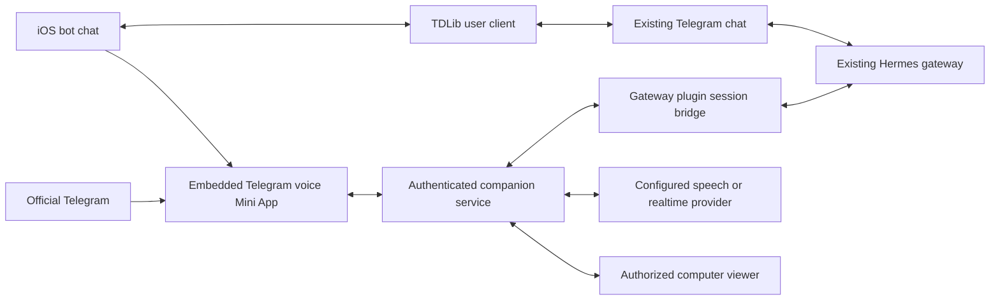

# iOS companion and Telegram voice call plan

Product decisions confirmed 2026-10-17; implementation contracts require the validation below.

## Implementation status

The first implementation is in [ios/](../ios/README.md) and [mobile/](../mobile/README.md): native TDLib bot chat, authenticated embedded Mini App hosting, avatar selection, an HTTPS computer viewer, and an installable Hermes voice plugin. The implementation preserves the existing gateway owner and binds launches to its canonical private-chat session and generation. Local protocol and simulator tests exercise those contracts with clearly labeled fixtures and synthetic credentials.

The current media transport records utterances, uploads them, and plays the correlated final reply through the profile's configured STT/TTS. Continuous streaming remains future work. Hermes' public plugin injection API does not expose its auxiliary voice reasoning-model override, so replies use the conversation's normal model. This implementation does not establish that the real-device continuity and approval gates below have passed.

The remaining integration inputs are this client's Telegram API ID/hash, an Apple development signing team, and a configured HTTPS voice Mini App deployment on the existing gateway. See the [iOS setup and verification instructions](../ios/README.md) and [gateway deployment instructions](../mobile/README.md). No production gateway, bot configuration, or signing account was changed by the build.

Build an iOS companion containing the full existing Telegram bot chat, a live view of the agent computer, and a call button that opens a Telegram Mini App inside the iOS app. The call screen uses the selected Hermes avatar across most of the screen and continues that exact bot's existing conversation. Telegram synchronizes the normal chat across devices; the existing Hermes gateway remains the owner of the agent session so subsequent typed messages remember the call.

Start by proving voice and conversation continuity on a real iPhone. Those contracts determine the implementation; the native interface follows. Supporting research lives in [Mobile voice feasibility](research/mobile-voice-feasibility.md).

## Existing foundations

The desktop app embeds official Telegram Web rather than running another bot gateway. It displays the remote computer through noVNC and keeps local Chromium automation in Electron. The mobile app can reuse the gateway/plugin contracts, viewer protocol, identity concepts and visual assets; Electron views, IPC and local browser automation require different iOS implementations. See [README](../README.md), [viewer implementation](../desktop/src/remote.js), and [desktop integration](../desktop/docs/integration.md).

The project already requires one authoritative conversation writer, authenticated profile/session binding and explicit failure when a particular computer is unavailable. Mobile must satisfy the existing [continuity gates](continuity.md). The current [security policy](../SECURITY.md) keeps the desktop control API on loopback behind SSH; adding a phone client must preserve that boundary.

Earlier sibling workspaces contain useful prototypes:

| Workspace and revision | Reusable work | Changes needed |
| --- | --- | --- |
| `agents-voice-hook` at `2cb35da1bcf08363b58ed220f9d07c405dfc1108` | Configurable `/call` Mini App link and gateway voice-turn hook | Validate against the installed Hermes public extension contract; replace text-based reply correlation and DM session construction |
| `agents-call` at `bbe53eb1cea38230fa043bdcadc5cddaedc24cda` | Telegram launch, authenticated audio ingestion, transcript and reply flow | Remove fixed speech choices, global call locking and assumed session format; add durable turn correlation and recovery |
| `openalan-voice` at `e85863fe8465eed0d83d65c2fccf6e04064f62b8` | Mini App call UI, microphone lifecycle and hosted endpoint discovery | Replace record-upload-wait-play behavior for conversational streaming; remove hosted-only assumptions |

These are implementation candidates in separate workspaces, not features present in this checkout or proof of live iPhone compatibility. Their current recording loop gates the microphone during replies and ends on backgrounding. The call daemon fixes the speech voice to `alloy`, with an Edge fallback, so it does not yet implement “use the agent's configured voice.”

## Product experience

In Telegram, the user opens the bot conversation and taps **Call**, provided by `/call` and eventually a persistent menu button. The Mini App opens to an immersive call screen with the agent portrait, connection/listening/speaking status, mute, transcript and hang up. A computer button reveals the live agent desktop while the conversation continues. Use Telegram themes, safe areas, haptics and supported fullscreen behavior. Telegram still owns its host interface and microphone permission prompts. [Telegram Mini Apps](https://core.telegram.org/bots/webapps)

In our iOS app, the user signs into their existing Telegram account and sees the same bots and conversation history they use on desktop and in Telegram. Normal messages, attachments and bot interactions remain in that Telegram chat. The conversation header's **Call** button opens the bot's Telegram Mini App in an in-app webview, retaining the selected bot/chat/session binding. The user stays inside our app throughout the call and returns directly to the same chat on hangup.

The selected Hermes avatar fills most of the call screen. Small controls provide mute, hang up, optional transcript and access to the computer view. Use restrained listening/thinking/speaking animation around that avatar. Resolve the avatar from the selected bot's presentation settings so the call screen does not accidentally show a different agent. Avatar synchronization across installations is a presentation feature to implement separately from Telegram message synchronization; existing desktop avatar overrides are local.

Calls only need to work in the foreground for the first release. On screen lock or backgrounding, stop capture and playback, release the microphone, and end the media session cleanly. Already accepted Hermes work remains visible in the chat and follows normal cancellation policy. CallKit, incoming calls and background audio continuity are outside the initial scope. Treat permission dialogs and temporary audio interruptions separately from leaving the app so they do not immediately end a new call.

Initial scope assumes calls initiated by the user to one bot's private conversation. Incoming agent calls, group/topic calls and changing devices during an active call follow once the basic experience is reliable. Keep the data model capable of chat topics from the beginning.

## Proposed architecture

Telegram carries normal chat, launches the Mini App and shows the call record. Audio uses our service and the configured speech provider. The viewer has its own authorized connection. The Bot API does not become a media transport or a second update consumer.

Use a native SwiftUI app with independent adapters for Telegram conversation, Mini App hosting and computer viewing. The web Mini App owns the call interface and media flow in both our app and official Telegram. This keeps plugin and Telegram changes behind versioned capabilities instead of tying each mobile release to desktop DOM details.

Full Telegram bot chat is part of the first release. Plan around TDLib for authenticated user messaging, history and updates, with a native chat interface. A Telegram application needs its own credentials and login flow. Establish the required feature coverage under Telegram's client terms during the integration spike. Telegram Web in a WKWebView remains a feasibility fallback, not the planned production chat architecture. [TDLib](https://core.telegram.org/tdlib), [TDLib setup](https://core.telegram.org/tdlib/getting-started), [Telegram client terms](https://core.telegram.org/api/terms)

## Hosting the Telegram Mini App

Our iOS app must implement a Telegram Mini App host in its WKWebView. Opening a website URL alone does not establish Telegram identity or the current conversation. Obtain the launch URL through TDLib's appropriate Web App operation for the bot menu/inline button or named Mini App link. Preserve the actual bot and chat, the server-issued launch binding and topic where applicable. Follow Telegram's required first-launch confirmation. TDLib documents `openWebApp` for bot menu and inline Web App buttons, and `getWebAppLinkUrl` for named app links. [Open Web App](https://core.telegram.org/tdlib/docs/classtd_1_1td__api_1_1open_web_app.html), [Web App link URL](https://core.telegram.org/tdlib/docs/classtd_1_1td__api_1_1get_web_app_link_url.html)

Implement the documented webview event bridge and the host behavior the call Mini App actually uses: readiness, theme and safe areas, fullscreen layout, back/close, activity state, haptics and microphone permissions. Expose supported versions and features accurately. Keep the bridge restricted to the trusted call origin, and handle Web App closure through the matching client lifecycle. Do not fabricate signed `initData` in JavaScript or require a handoff to the separate Telegram app. Test this host independently from official Telegram iOS. [Telegram web events](https://core.telegram.org/api/web-events)

## Voice configuration and behavior

Resolve voice settings on the server for the selected Hermes profile at call start. Expose readiness, supported modes and a nonsecret description to clients. Keep bot tokens and provider credentials on the server. Honor the effective upstream configuration and its fallback rules rather than duplicating them in Swift or the Mini App. Apply configuration changes to the next call unless a provider supports an explicit safe transition.

Hermes currently distinguishes speech recognition, speech synthesis, an optional auxiliary model for voice chat, and a full-duplex voice mode. These are separate choices. A configured synthesis voice alone does not supply a speech-to-speech session. Current upstream documents both a chained speech pipeline and a GPT-Live mode that delegates work to Hermes. [Hermes voice configuration](https://github.com/NousResearch/hermes-agent/blob/main/website/docs/user-guide/features/voice-mode.md)

Support two capability-dependent paths:

1. **Configured chained voice:** stream microphone audio to recognition, admit the completed utterance into the existing Telegram conversation, and stream the Hermes response through the configured synthesis provider. Prioritize quick speech onset, echo control and interruption. Providers without streaming synthesis can still work with higher latency.
2. **Configured realtime voice:** reuse the supported Hermes realtime setup when installed and configured. Route delegated work into the same Telegram conversation. Ensure ordinary spoken exchanges also become available to the next typed Hermes turn; delegation alone does not establish full conversation continuity.

Every completed spoken exchange must have a defined persistence path. If the upstream realtime integration cannot persist the full exchange through supported APIs without a second model turn, retain chained voice for the initial same-context release and treat realtime integration as an upstream requirement. Do not create an independent voice assistant with a copied history.

The UX must distinguish **stop speaking**, **cancel pending turn**, and **stop agent work**. Interrupting playback must not silently cancel tools or roll back actions already performed. An interrupted reply may remain in chat; show that clearly.

## Shared conversation contract

The service must resolve the authorized installation, Hermes profile, bot ID, Telegram user, chat and optional topic into the existing gateway's canonical session. Let Hermes derive session keys; do not manufacture `agent:main:telegram:dm:...` or assume a user ID identifies every chat. Bind each call to both its logical conversation and current session generation so `/new` or a reset cannot silently retarget it.

Validate Telegram Mini App `initData` on the backend, check freshness and bot identity, and authorize the user against the installation. Resolve the chat/topic from an authorized launch binding issued for that conversation. Mini App context varies by launch type; `chat_instance` is not the Bot API chat ID. A query-string computer ID or client-supplied session key cannot authorize attachment. In our iOS app, obtain genuine Telegram launch data through the authenticated Telegram client. Separate device pairing may authorize the computer viewer but cannot substitute for the Mini App's Telegram identity. [Telegram initialization and validation](https://core.telegram.org/bots/webapps#validating-data-received-via-the-mini-app)

Every tap starts a new media call attached to the existing Hermes conversation. Ending and redialing must preserve that conversation. Changing the selected bot must never retarget an active call; hang up or explicitly finish the old call first.

The plugin must admit voice turns through the existing gateway owner and its busy/approval queues. A generic API completion endpoint must not be assumed to accept an existing Telegram session. Use supported plugin/native session interfaces; if they cannot provide the required semantics, propose the missing upstream contract. Avoid private imports, monkey patches and direct database writes, as required by [Contributing](../CONTRIBUTING.md).

Assign call and turn IDs before admission. Track acceptance, execution, final response, speech delivery and Telegram delivery separately. Reconnect queries status; it never resubmits an uncertain turn automatically. Correlate responses by turn identity, not matching transcript text or the first model callback. Tool use can involve several model calls before the final answer.

Persist the spoken user turn once in the canonical Hermes transcript. Show a clearly labeled bot-authored voice transcript or call record in Telegram when injection cannot create a user-authored bubble. Deliver the assistant answer once through the gateway. Native Telegram sends and plugin injection must never both execute the same voice turn. Preserve routing and approvals when typed messages arrive during a call.

## Viewing the computer

Reuse the existing noVNC/websockify path for the first mobile viewer, embedded in an isolated WKWebView. noVNC supports mobile browsers and touch gestures. Add landscape, pan/zoom, keyboard support if control is selected, connection status and reconnection. Start in watch mode. [noVNC](https://novnc.com/noVNC/)

The MVP target is the agent's remote VPS or VM desktop. Viewing the user's local desktop or mirroring individual Electron browser tabs is additional work with separate host permissions and availability. Label the computer being shown. The phone must attach directly through an authorized service so the remote viewer works while the desktop app is closed.

If remote control is included, coordinate human and agent activity before forwarding input. The current VNC **Take control** toggle does not itself pause agents. Browser control epochs already provide useful policy, but a general desktop control lease needs its own enforcement. A viewer-only restriction must be enforced by the service, not solely by noVNC's client flag. See [desktop integration](../desktop/docs/integration.md).

Keep raw VNC, Chromium debugging, Hermes administration and the desktop loopback control token private. For an initial personal beta, test iPhone Tailscale access to authenticated HTTPS/WSS endpoints. A public release needs a stable authenticated relay or narrow ingress service with expiring call/viewer grants. The earlier ephemeral quick-tunnel prototype is not the release endpoint contract. Mini App access to private endpoints, TLS, microphone permission and network transitions are device-test gates.

## Delivery sequence

| Phase | Deliverable | Exit condition |
| --- | --- | --- |
| 1. Prove the contracts | Installed-version capability audit, TDLib login/chat sync and a minimal embedded Mini App call on a real iPhone | The selected existing bot/chat launches with valid Telegram identity; voice uses that profile's configuration; a detail from text is recalled in the call and a new spoken detail is recalled in a later typed message in the same session |
| 2. Build the shared service | Gateway bridge, authentication, call lifecycle, turn IDs, transcript handling and configured speech adapters | Concurrent typed/voice turns, approval requests, timeout, reconnect and session reset produce no duplicate execution or cross-chat response |
| 3. Ship the Telegram Mini App beta | Avatar-centered call UI and streaming audio, with the chosen viewer scope | Successful microphone, echo, interruption, hangup, route-change and network tests in official Telegram and our iOS host; capture stops and accepted work remains recoverable after lock/background |
| 4. Build the iOS TestFlight app | Telegram login, agent list, full bot chat, embedded Mini App host and computer viewer | Existing chat syncs across devices; correct avatar and bot session open on call; real iPhone works with desktop app closed; AirPods, speaker and interruption behavior pass |
| 5. Release and maintain | Stable endpoints, diagnostics, compatible upgrades, privacy controls and App Store assets | Supported Hermes/plugin versions and device matrix pass; server capability changes fail visibly and recover safely |

The first milestone should demonstrate one complete loop: **open an existing bot chat in our iOS app → confirm a message from another device appears → tap Call → see that bot's Hermes avatar → discuss the same task → watch its computer → hang up → continue typing with the call remembered on every device**. Repeat with a second bot to prove context and identity remain separate. That settles the central product risk before extensive interface work.

Measure call connection time, end-of-speech to first audible response, interruption-to-silence, reconnect time and viewer bandwidth on Wi-Fi and cellular. Define targets after a baseline with the actual configured providers; model and tool execution time cannot be hidden by the interface.

## Confirmed scope and remaining choice

The first release includes full Telegram bot chat inside the iOS app, the existing account/bots/conversations, an in-app Telegram Mini App call bound to the selected conversation, an avatar-centered call screen, and foreground calling. The same Mini App can also launch in official Telegram. All completed call exchanges must remain available to the continuing Hermes conversation.

Human control in the phone viewer remains undecided. Proceed with viewing as the baseline and keep control as an optional addition; it does not block chat or voice work. Initial testing uses one existing personal installation; broader hosted onboarding follows the same protocol after the private beta.
